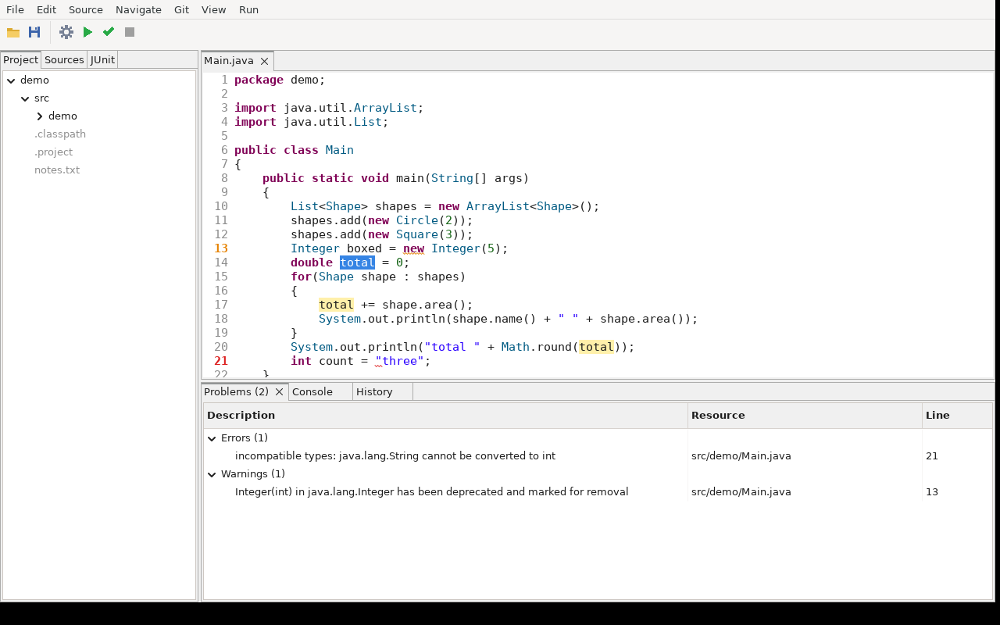
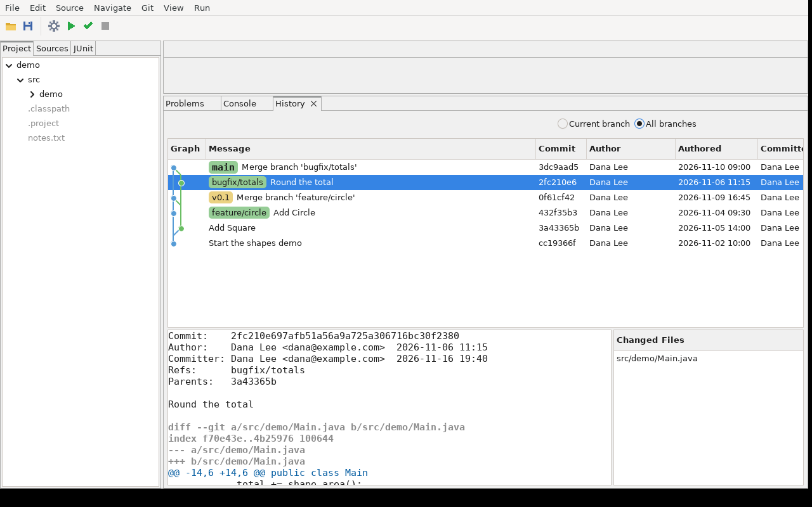
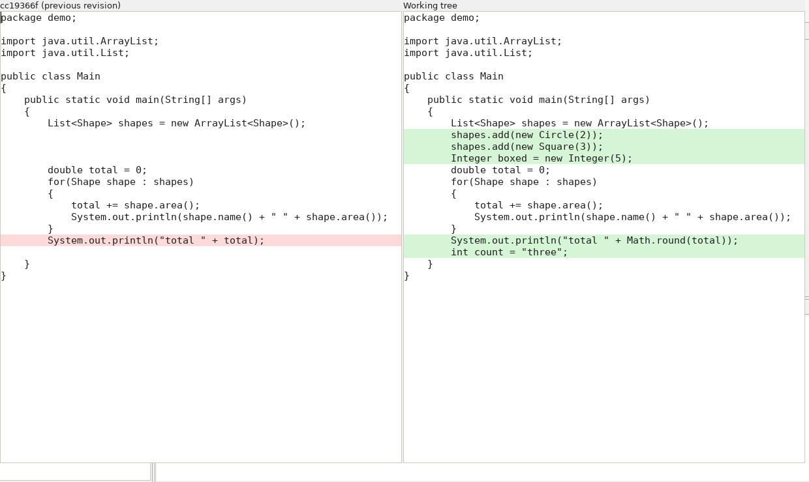

# JavaPad

A small desktop editor (SWT) for Eclipse-style Java projects. It opens a project folder (`.project` and `.classpath`, created if missing), edits its sources, and builds, runs and tests the project with the JDK it runs on.



## Features

- **Editor:** syntax colouring (dark and light themes), content assist, imports, quick fixes and formatting, all based on javac's analysis of the project. Selecting an identifier highlights its other uses.
- **Build, run, test:** compiles in process, runs main classes and JUnit 4 or 5 tests, and shows problems, console output (which also takes input) and test results.
- **Terminal:** a tab with your login shell on a real pseudo-terminal (colours, full-screen programs, scrollback), starting in the project folder.
- **Navigation:** open a declaration or implementation, call hierarchy, open a file by name, search the project's files.
- **Git:** status in the sidebar, commit, branches and the usual commands, a history view with a commit graph, and side by side file comparison.

| History | Comparing a file with an earlier version |
| --- | --- |
|  |  |

Press **Ctrl+3** to run any menu command, switch to an open tab, or find a git command by name.

## Build and run

```
mvn package                      # target/javapad.jar (everything inside) and lib/ (the jars below)
java -jar target/javapad.jar [project-folder]
```

Without Maven: put the jars in `lib/` on the class path, compile `src/main/java` with `javac`, and run `javapad.JavaPad`. The JDK must provide `jdk.compiler`. The git features need `git` on the PATH.

## Keyboard shortcuts

| Keys | Action |
| --- | --- |
| Ctrl+3 | Run command |
| Ctrl+Shift+R | Open file by name |
| Ctrl+F / Ctrl+Shift+H | Find / find in files |
| Ctrl+Space | Content assist |
| Ctrl+1 | Quick fix |
| Ctrl+Shift+O / Ctrl+Shift+F | Organize imports / format |
| F3 | Open declaration |
| Ctrl+B | Build |
| Ctrl+R / F11 | Run the active file / repeat the last run |
| Ctrl+F11 | Run the tests |

The menus show the rest.

## Code map

| Package | What it holds |
| --- | --- |
| `javapad.ui` | The SWT window (`MainWindow` and the classes it delegates to) and the editor. |
| `javapad.lang` | Code intelligence on javac's Tree API, the formatter, and text search. No SWT. |
| `javapad.git` | The `git` command line and what is parsed from it. No SWT. |
| `javapad.run`, `javapad.build` | Compiling, and starting programs and tests. |
| `javapad.model` | The Eclipse project files and `.gitignore` rules. |
| `javapad.runner` | Classes that run inside the edited project's JVM. |

Code style: tabs, `if(`, braces on every block and on their own line, one statement per line, fields first.

## Tests

`src/test/java` holds JUnit 4 tests for everything that does not need a display. Run them with JUnitCore against `target/classes`, or from your IDE.

## Headless runs

`Automation` reads `-Djavapad.*` properties (`open`, `action`, `tab`, `shot`, …) so a run can be driven and screenshotted under `xvfb-run`; see the constants at the top of `ui/Automation.java`. Run with `-Djavapad.theme=light` for the light theme.
